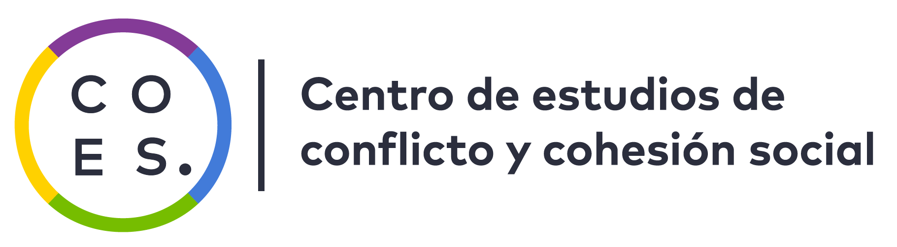
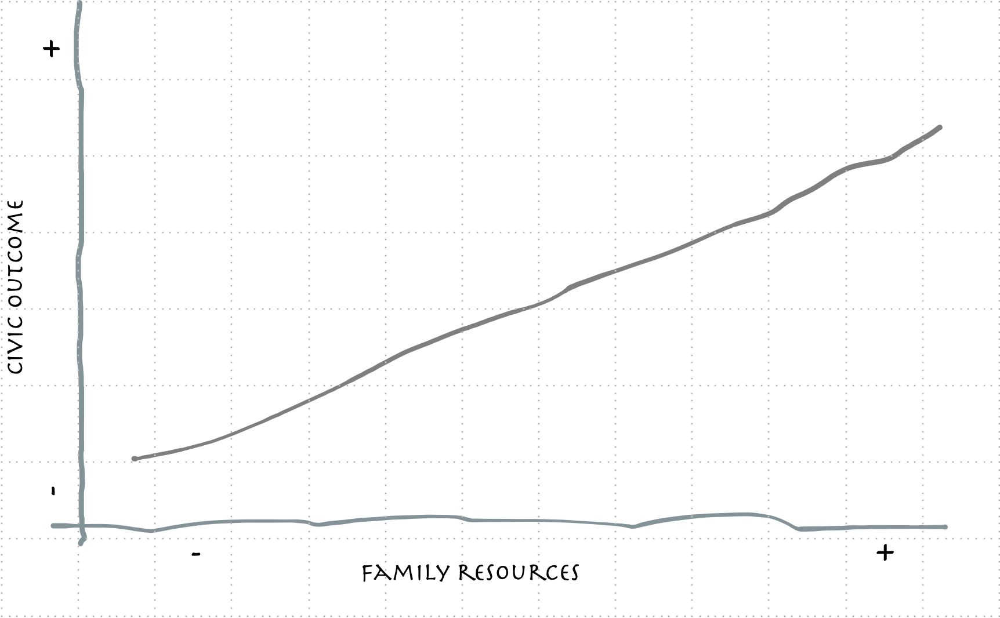
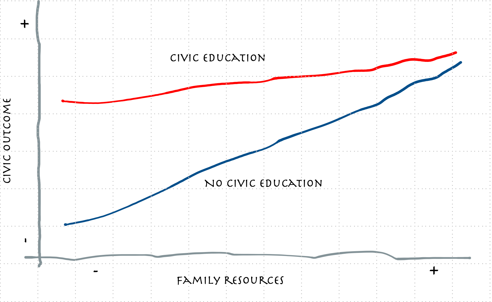
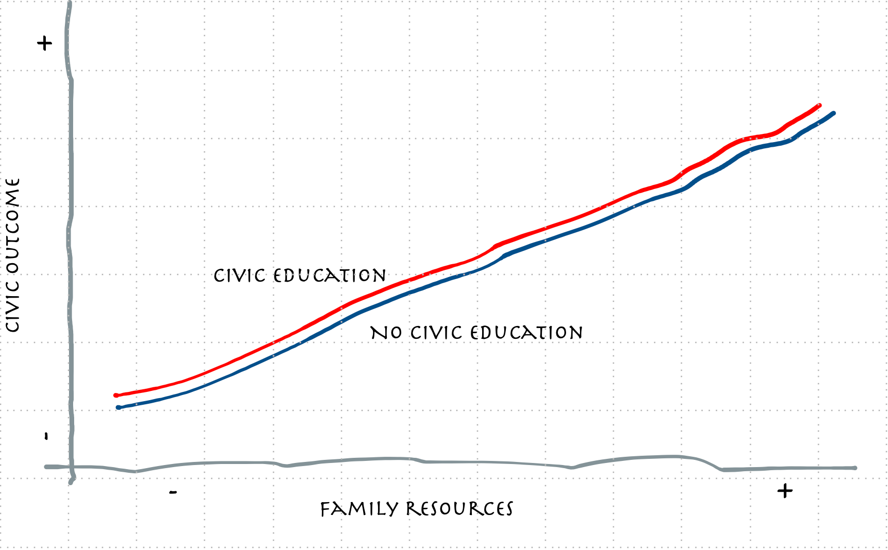
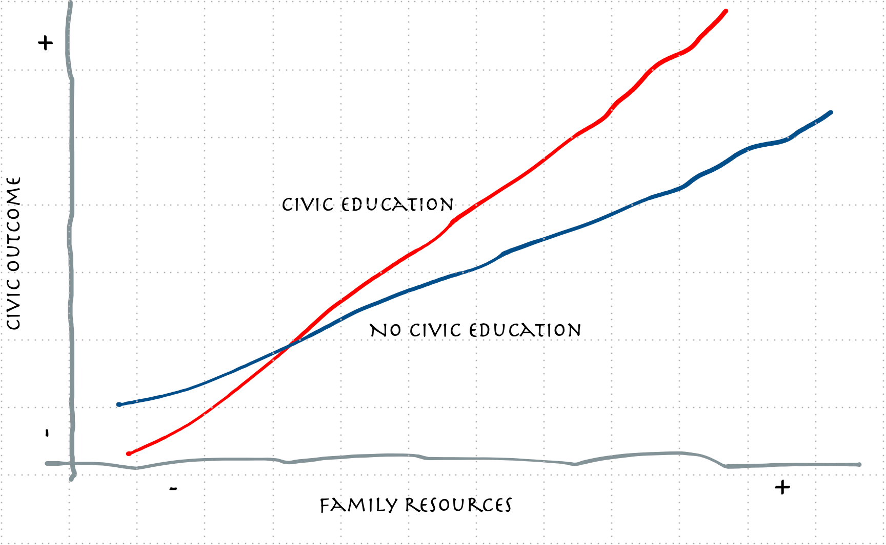
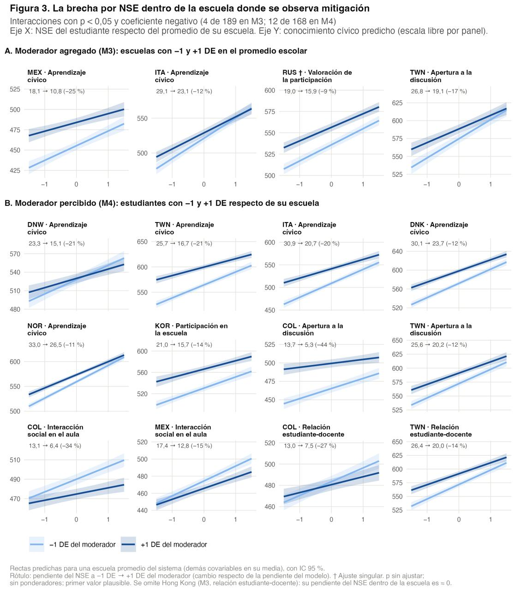
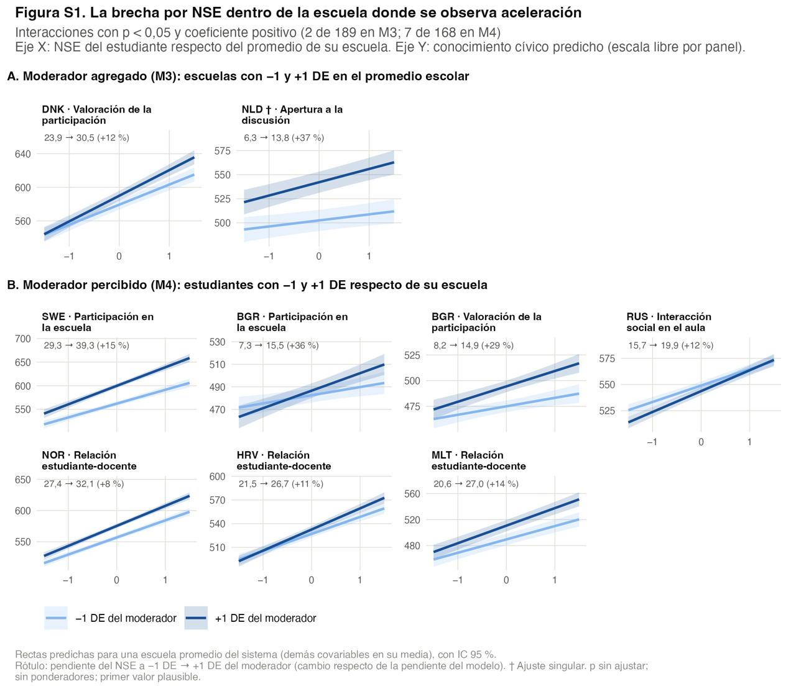
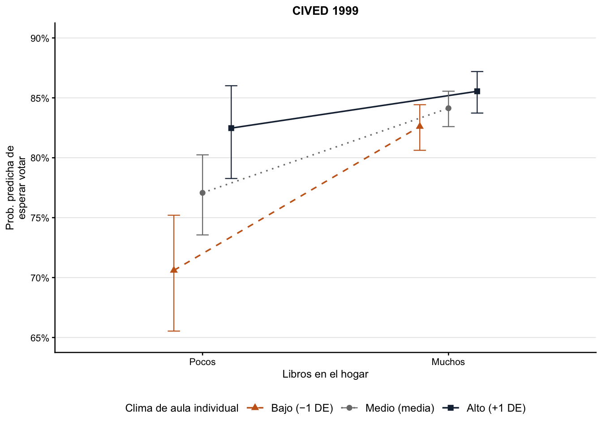

::: columns
::: {.column width="10%"}

:::

::: {.column .column-right width="85%"}
 

### **¿Puede la educación cívica compensar las desigualdades sociales en los resultados cívicos: evidencia desde Chile y comparada (using ILSA's).**

------------------------------------------------------------------------

**Daniel Miranda**

#### Departamento de Psicología, Universidad de Chile

##### Núcleo Milenio de Desigualdades y Oportunidades Digitales (www.nudos.cl)

##### Centro de Estudios de Conflicto y Cohesión Social (www.coes.cl)

##### FONDECYT 1240922: Actitudes y comportamientos políticos juveniles: desigualdad, estilos de socialización escolar e influencias intergeneracionales

Conference 2026: "Evaluation and Resrach Education". 
November 4-6. Lecco, Italy.
:::
:::

## Agenda de investigación sobre educación ciudadana

-   ¿Por qué realizar una investigación sobre este tema?

    -   Proyecto actual y proyecto previo sobre socialización política

    -   Las preguntas generales de investigación que abordamos fueron:

        -   ¿Cuáles son los factores y mecanismos que explican la transmisión intergeneracional de la desigualdad política?

        -   ¿En qué medida la escuela es un agente que reproduce o mitiga la transmisión intergeneracional de la desigualdad política familiar?

## Desigualdad política

::: {.incremental .highlight-last style="font-size: 100%;"}
-   La desigualdad política constituye una amenaza para los principios del sistema democrático [@burns1997; @solt2008].

-   El buen funcionamiento de la democracia se sustenta en que sus ciudadanos participen en igualdad de condiciones en los procesos de toma de decisiones, se interesen por asuntos de relevancia social y política, adhieran a los principios democráticos y desarrollen actitudes y conocimientos acordes con la vida en una sociedad democrática.

-   Las personas, según su nivel educativo, recursos económicos, género u origen nacional, pueden presentar distintos grados de acceso a la voz política, interés en la política, conocimientos, adhesión a valores o principios democráticos, etc.
:::

## Origen familiar y resultados cívicos

::: {.incremental .highlight-last style="font-size: 100%;"}
-   Las desigualdades políticas se observan en la población adulta y desde edades tempranas [@castillo2014; @meirick2004; @miranda2023]

-   La familia transmite creencias, actitudes, conocimientos y habilidades pertinentes para el ejercicio de la ciudadanía, socializando directamente a sus hijos e hijas.

-   Además, la familia transmite las ventajas de su posición social a la siguiente generación, lo que se traduce en una transmisión de la desigualdad política.
:::

## Origen familiar y resultados cívicos

## Hipótesis de compensación

::: {.incremental .highlight-last style="font-size: 100%;"}
-   El sistema escolar ofrece una serie de actividades, definidas tanto formal como informalmente, que tienen el potencial de desarrollar aspectos relevantes para el ejercicio de la ciudadanía.

-   La hipótesis de compensación propone que la experiencia escolar, idealmente similar para todas las personas que asisten, puede nivelar, moderar, mitigar o compensar las brechas causadas por el origen social [@campbell2019].

-   @langtonPoliticalSocializationHigh1968 describen que la clase media (socioeconómicamente aventajada) se beneficia menos de la educación cívica que la clase trabajadora (socioeconómicamente desfavorecida, como la población afroamericana en su estudio) debido a la redundancia de la información (efecto techo, [@neundorf2016a]).
:::

## Compensación de las desigualdades (mitigación)

## Mantenimiento de las desigualdades

## Aumento de las desigualdades

## 

::: {style="font-size: 150%; display: flex; justify-content: center; align-items: center"}
  *Este estudio examina esta tensión evaluando si la educación cívica escolar compensa las desigualdades de origen en Chile y en un conjunto amplio de países.*
:::

# Estudio 1

::: {.incremental .highlight-last style="font-size: 100%;"}
-   Se basa en el estudio internacional ICCS 2016 para comparar los resultados entre países.

-   Se analizó el **conocimiento cívico** como variables dependientes, considerando el nivel socioeconómico como predictor central.

-   A nivel escolar, se consideran prácticas como el clima abierto de discusión, las actividades participativas y la educación cívica formal.

-   Se estimaron modelos jerárquicos multinivel con interacciones entre el nivel socioeconómico y prácticas escolares.
:::

# Estudio 2

::: {.incremental .highlight-last style="font-size: 100%;"}
-   Analiza la evolución de las desigualdades cívicas en Chile utilizando las bases CIVED 1999, ICCS 2009, ICCS 2016 y una muestra nacional de 2019 (estudiantes secundarios).

-   Se analizó el **Disposición a votar** como variables dependientes, considerando el nivel socioeconómico como predictor central.

-   A nivel escolar, se consideran prácticas como el clima abierto de discusión, las actividades participativas y la educación cívica formal.

-   Se estimaron modelos jerárquicos multinivel con interacciones entre el nivel socioeconómico y prácticas escolares.
:::

## ¿Cómo se define la educación cívica? {.small}

::: {.incremental .highlight-last style="font-size: 100%;"}
-   Actividades orientadas al contenido: asignatura

-   Actividades orientadas a la participación: elecciones, foros, etc.

-   Foco en las relaciones sociales: entre estudiantes, entre estudiantes y profesores
:::

# Resultados {data-background-color="#d3d3d3"}

## Estudio 1

::: {.incremental .highlight-last style="font-size: 80%;"}
{fig-align="center" width="60%"}
:::

## Estudio 1

::: {.incremental .highlight-last style="font-size: 80%;"}
{fig-align="center" width="75%"}
:::

## Estudio 2

::: {.incremental .highlight-last style="font-size: 100%;"}
-   En los cuatro estudios el resultado es *reproducción*. Es decir, no hay efecto de interacción.

-   Esto no implica que la educación cívica no es relavante para aumentar la intención de votar, pero no se produce compensación de desigualdades.
:::

## Estudio 2

{fig-align="center" width="75%"}
:::

# Discusión

::: {.incremental .highlight-last style="font-size: 100%;"}
-   La evidencia a favor de la hipótesis de compensación es limitada, considerando la escuela como un contexto (México, Italia, Rusia, Taiwan).

    -   Asignatura, participación y discusión.

-   La evidencia a favor de la hipótesis de compensación es limitada, considerando la percepción sobre la escuela (12 países).

    -   Asignatura, participación, discusión y relaciones sociales.
:::

# Discusión

::: {.incremental .highlight-last style="font-size: 100%;"}
-   Sin embargo, tambien se observa incremento de las desigualdades (en 2 países considerando la escuela como un contexto y en 7 considerando la percepción sobre la escuela).

-   Al considerar el estudio 2, no se observa compensación de las desigualdades de origen.

-   Por lo tanto, el resultado más común es la reproducción.
:::

# ¿Qué viene?

::: {.incremental .highlight-last style="font-size: 100%;"}
-   Sistematizar los resultados

-   Versiones futuras de ICCS 2027

-   Foco en Enseñanza Media
:::

# ¡Muchas gracias!

## Referencias
