class: front, middle

```{r xaringanExtra, echo=FALSE}
xaringanExtra::use_xaringan_extra(c("tile_view", "animate_css"))
xaringanExtra::use_progress_bar(color = "red", location = "top")

# xaringanExtra::use_share_again()
# xaringanExtra::use_scribble()
```

.pull-left-narrow[
.left[


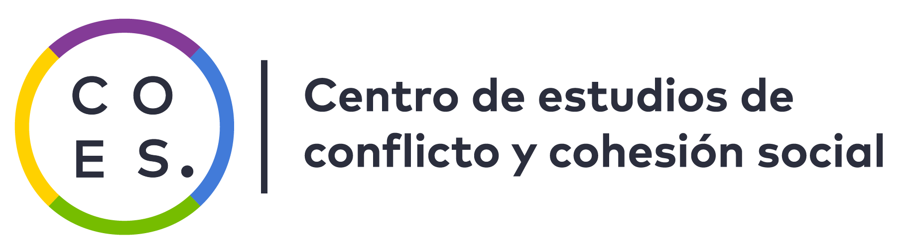
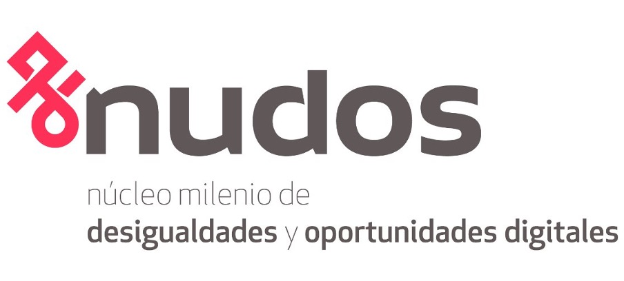

.tiny[
.grey[
My work is supported by:

ANID/FONDAP-COES/15130009 - 1523A0005

ANID/MILENIO-NUDOS/Ncs2022_046

ANID/FONDECYT/1240922

]
]

]
]

.medium[
.pull-right-wide[
.right[
.content-box-gray[
.small[
## .black[Pro-Environmental Dispositions among Secondary School Students:]

## .red[Exploring the Gender and Socioeconomic Gaps]
]
]]

.content-box-blue[
.small[
.black[**Daniel Miranda** MIDE-UC, Pontificia Universidad Católica de Chile. 

**Diego Carrasco** MIDE-UC, Pontificia Universidad Católica de Chile.


**.small[.black[Contact:].blue[damiran1@uc.cl]**]
]

.content-box-red[
.center[
.medium[
**68th Annual Meeting Conference of the Comparative and International Education Society**
<br style="content:''; padding: 0,3px 0;" />

March 10-14th 2024, Miami, EEUU.]
]
]
]
]
]
]

---

layout: true
class: animated, fadeIn


---
**Context**

- **PRICE**: Research Program in School Citizenship (https://ciudadania-escolar.cl/)

- **Thematic Report**: Environmental knowledge and willigness to act pro-envoronmentally: a comparative perspective using IEA TIMMS 2019 and ICCS 2016 data.

    
---
**Pro-environmental willigness of youth**

.pull-left[
.medium[
The growing interest and participation of young people in climate activism in many countries underscores the importance of understanding their willingness to act pro-environmentally (Bessant et al., 2021; Pickard, 2023).

Action Competence for Sustainable Development framework considers acquisition of relevant knowledge and skills, willingness to contribute to finding a solution, and self-efficacy regarding a controversial problem.

This chapter is focused on the willingness as a strong motivation, or passion, and commitment to contribute.
]
]

.pull-right[
```{r, echo=FALSE, out.width = '100%', fig.retina = 1, fig.align='center'}
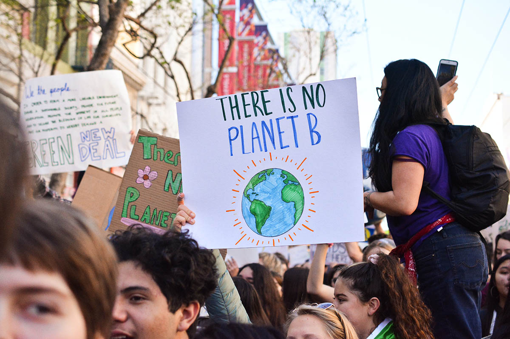
```
]
  
---
**Research focus**

This chapter aims to assess gaps in young people’s willingness to contribute to environmental preservation.

Several studies indicate that women tend to exhibit greater pro-environmental attitudes and behavior (Gifford & Nilsson, 2014; Li et al., 2019).

Adding to these findings, the political socialization literature suggests that the family plays a crucial role in shaping the development of sociopolitical attitudes, particularly in areas related to social position or family academic orientation (Miranda, et al., 2018).

---
**Research focus**
.medium[
.pull-left[
.content-box-red[
.red[Gaps]

- Gender differences (Duarte, et al., 2017)

- Family characteristics (Miranda, 2018):

  - Tertiary education and scholarly culture

- Immigration status  

]]

.pull-right[
.content-box-yellow[
.red[Moderation effects]

- Students who would benefit most from the greater availability of books would be those in the lowest socioeconomic positions (Sikora, et al., 2015) (achievement)

- Gender gaps varies by family education? 

- Gender gaps varies by scholarly culture?

]]
]

---
**Data**

- International Civic and Citizenship Study ICCS 2016.

   + ICCS 2016: 24 countries

- National representative of 8th grade students.
  
---
**Dependent variable**

A single item asking if students are willing to make personal efforts in their adult life to help the environment.

This question is addressing students’ intended future behavior to protect the environment in terms of their willingness to make individual efforts. The selected item has been used in previous studies as an indicator of sustainable development dispositions (Sandoval-Hernández & Carrasco, 2020), and as an indicator of environmental citizenship (Huang & Cheah, 2021).

---
**Dependent variable**

```{r, echo=FALSE, out.width = '55%', fig.retina = 1, fig.align='center'}
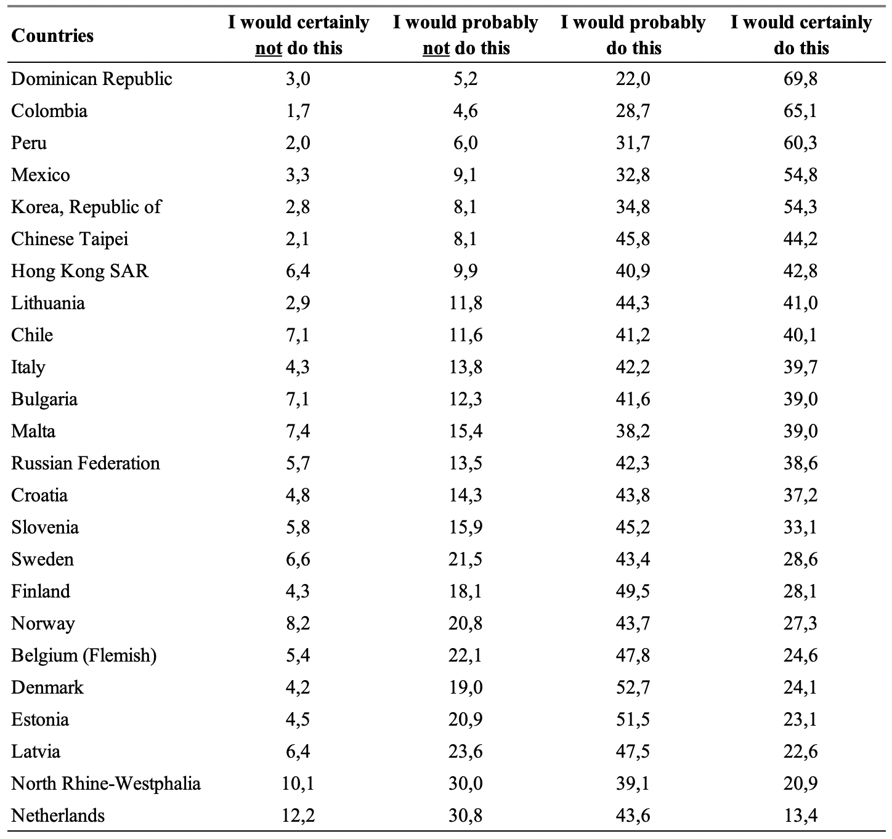

```

---
**Independent variables**

- Student sex

- Parents' education: Basic, Secondary, Technical, **University**

- Books at home: **more than 100** vs less

- Immigration status: **Immigration background** vs no


---
**Methods**

- To address the different research questions included in the next chapters, we fitted a series of ordinal logit models (Rabe-Hesketh & Skrondal, 2012) onto the pooled data of the study including countries’ fixed effects, while including the sampling design of the ICCS 2016 study in our estimations, using Mplus software (Muthén & Muthén, 2017).

- Survey weights were scaled up to constant, so all participating countries contributed equally to the estimates (Gonzalez, 2012).

- We used Taylor Series Linearization to get corrected standard errors of estimates (Asparouhov & Muthén, 2010).

---
**General results**

```{r, echo=FALSE, out.width = '80%', fig.retina = 1, fig.align='center'}
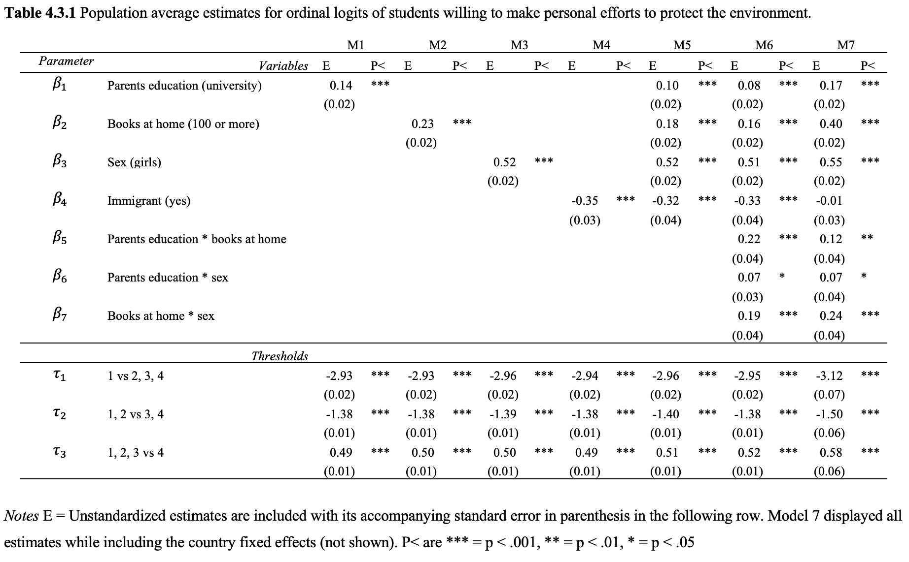

```

---
**Parent´s education gaps**

```{r, echo=FALSE, out.width = '40%', fig.retina = 1, fig.align='center'}
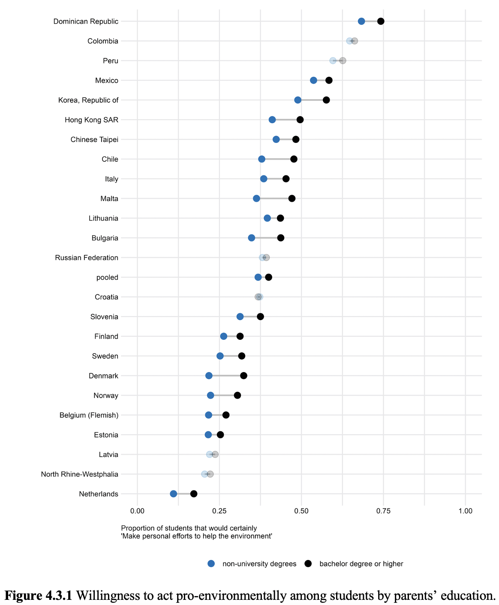

```

---
**Scholarly culture gaps**

```{r, echo=FALSE, out.width = '40%', fig.retina = 1, fig.align='center'}
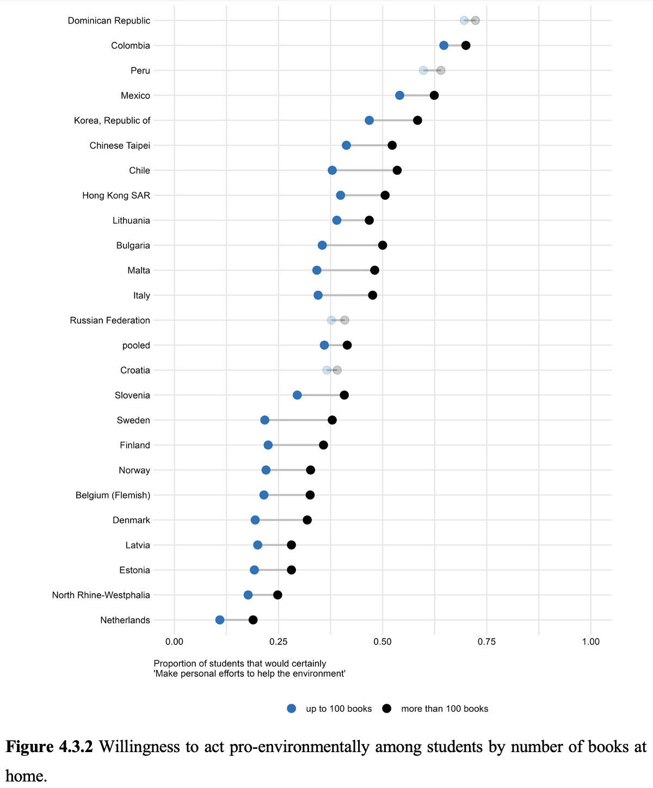

```

---
**Gender gaps**

```{r, echo=FALSE, out.width = '40%', fig.retina = 1, fig.align='center'}
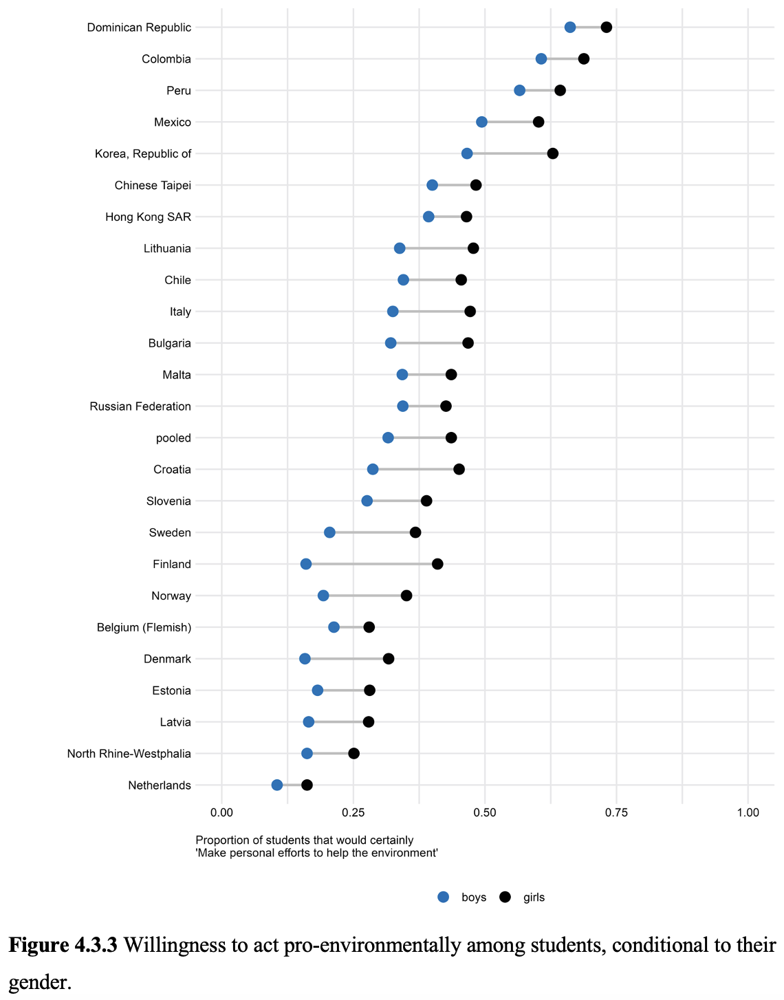

```

---
class: inverse animated slideInRight fadeOutLeft

## .yellow[Moderation role of education and family scholarly culture
]

 
---
**Scholarly culture gaps, by education**

```{r, echo=FALSE, out.width = '80%', fig.retina = 1, fig.align='center'}
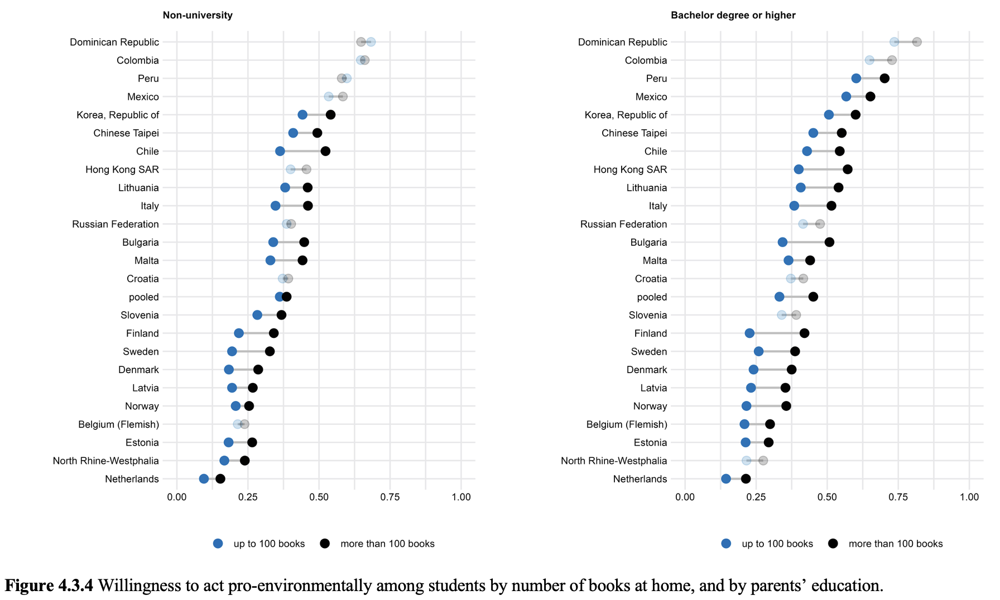

```

---
**Gender gaps, by education**

```{r, echo=FALSE, out.width = '80%', fig.retina = 1, fig.align='center'}
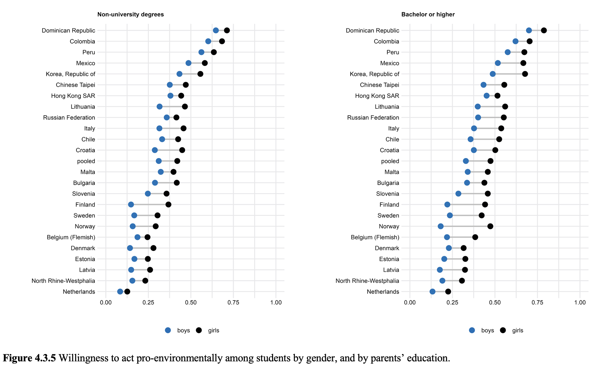

```

---
**Gender gaps, by scholarly culture**

```{r, echo=FALSE, out.width = '80%', fig.retina = 1, fig.align='center'}
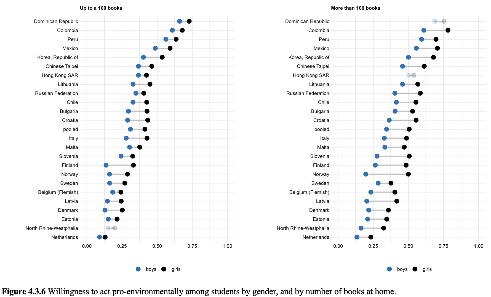

```


---
**Discussion**
.medium[
- Students who come from families with a university education (at least one of the parents), and students who come from families with a greater availability of books (more than 100 books) generally tend to show a greater willingness to “make personal efforts to help the environment”.

  - People with more privileges have greater chances of developing these types of attitudes (Post-materialistc values)

- The results also show that gender and immigration status are important aspects when considering inequalities around the development of pro-environmental attitudes. Consistent with results from previous literature (Gifford & Nilsson, 2014), it is shown that girls show a greater willingness to make personal efforts to care for the environment.

  - Differences in socialization between girls and boys, and in the country of origin (Zelezny, et al., 2000).
]
---
**Discussion**

.medium[
- The present results are not consistent with the _compensation scholarly culture_ hypothesis.

  - Students who have a greater availability of literary resources (more than 100 books on site) develop a greater willingness to make personal efforts to protect the environment when they grow up in families with higher education attainment (bachelor’s degrees or higher).
  
  - This supports the traditional idea that different forms of stratification enhance each other, and that they could be used interchangeably since they show a similar history (acceleration, double geeopardy)
]
---
**Discussion**
.medium[
- However, when focusing on the results per country, we observed a more complex pattern. For example, in Chile the gap between students with less and more books at home, is higher among the less educated families. 

  - These results highlight the need for research into the compensation hypothesis of scholarly culture, not only in measures of achievement but also regarding civic dispositions.
  
  - As recent research has shown, it is relevant to distinguish the differentiated effects that these stratification measurements can have on sociopolitical results (Miranda, 2023).
]
---
class: front middle


.pull-left-narrow[
.left[


.tiny[
.grey[
My work is supported by:

ANID/FONDAP-COES/15130009 - 1523A0005

ANID/MILENIO-NUDOS/Ncs2022_046

ANID/FONDECYT/1240922

]
]

]
]

.medium[
.pull-right-wide[
.right[
.content-box-gray[
.small[
## .black[Pro-Environmental Dispositions among Secondary School Students:]

## .red[Exploring the Gender and Socioeconomic Gaps]
]
]]

.content-box-blue[
.small[
.black[**Daniel Miranda** MIDE-UC, Pontificia Universidad Católica de Chile. 

**Diego Carrasco** MIDE-UC, Pontificia Universidad Católica de Chile.


**.small[.black[Contact:].blue[damiran1@uc.cl]**]
]

.content-box-red[
.center[
.medium[
**68th Annual Meeting Conference of the Comparative and International Education Society**
<br style="content:''; padding: 0,3px 0;" />

March 10-14th 2024, Miami, EEUU.]
]
]
]
]
]
]
