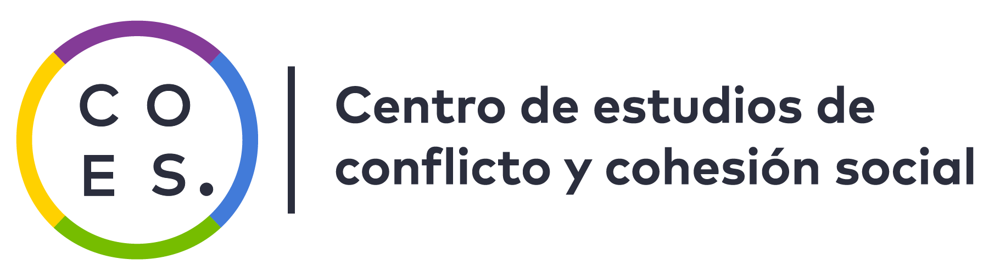
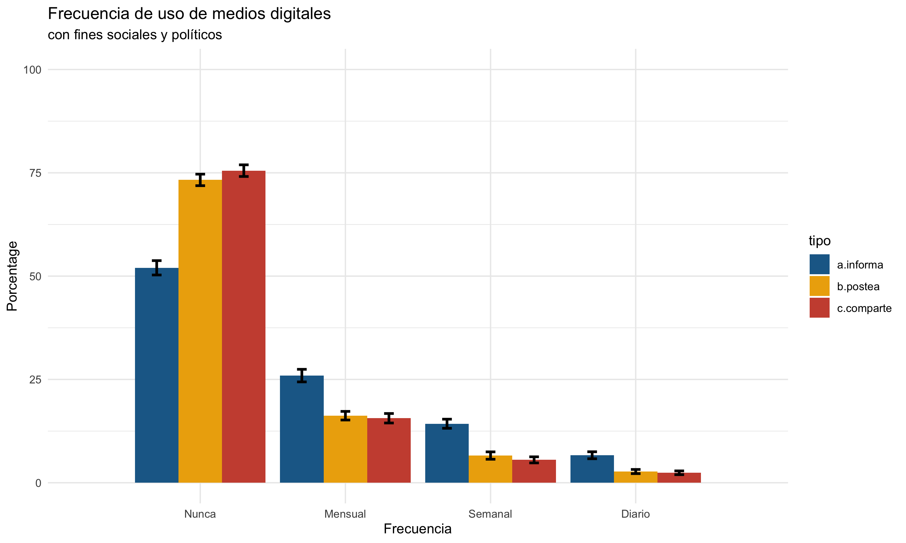
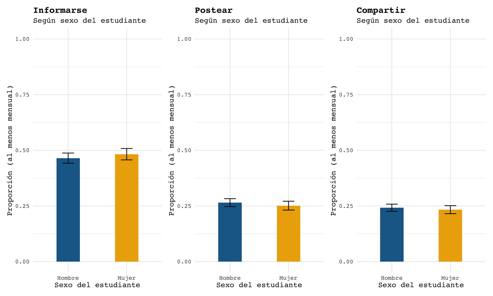
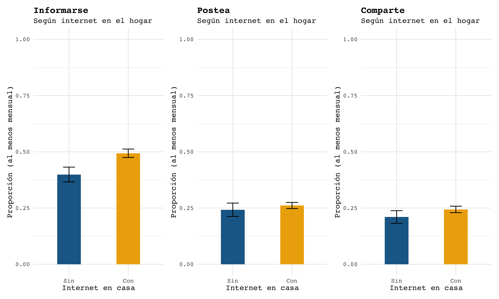
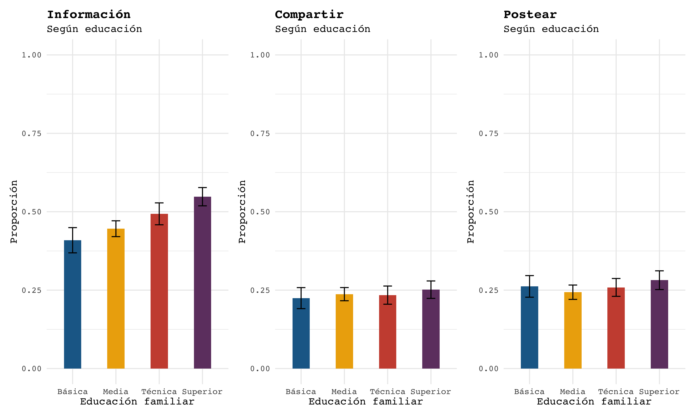
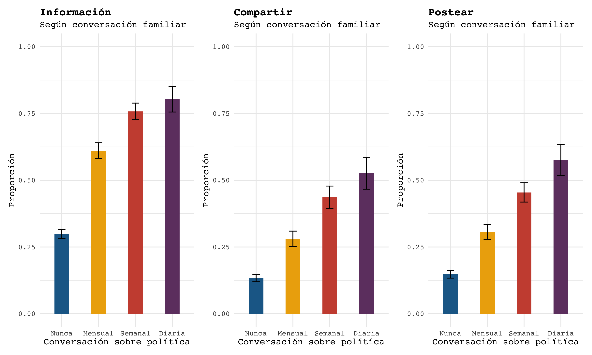

class: front, middle

```{r xaringanExtra, echo=FALSE}
xaringanExtra::use_xaringan_extra(c("tile_view", "animate_css"))
xaringanExtra::use_progress_bar(color = "red", location = "top")

# xaringanExtra::use_share_again()
# xaringanExtra::use_scribble()
```


.pull-left-narrow[
.left[





.small[
.grey[

]


.blue[
Jornada de Adolescencia y Entornos Digitales

FACSO]
]

]
]

.medium[
.pull-right-wide[
.right[
.content-box-gray[
## .red[Participación Ciudadana Digital:]
<br style="content:''; padding: 0,5px 0;" />
### .text_50[medición y descripción de brechas]
]]
]

.content-box-red[
.medium[
**Daniel Miranda**- Departamento de Psicología, Universidad de Chile


Contacto:.blue[danmiranda@uchile.cl]
]
]
]

---

layout: true
class: animated, fadeIn


---
**Contexto**

- **Fondecyt Regular 1240922**: Investigación en Formación Ciudadana en la Etapa Escolar

- **Ciudadanía Digital**: Núcleo Milenio sobre Desigualdades y Oportunidades Dígitales

  - La expansión acelerada del uso de herramientas digitales en diferentes esferas de la vida ha modificado múltiples aspectos de la vida
  
  - Por ejemplo, la forma en que los ciudadanos se manifiestan en el espacio público
  
    + Comprender las formas en que se ejerce la *ciudadanía* usando medios digitales 
    

---
**Ciudadanía Digital**

- Diferentes aproximaciones conceptuales y de medición (Chen, et al., 2021)

  + Competencias digitales (literacidad): habilidades/información
  
  + Uso de tecnologías digitales/prácticas: uso de técnologias para múltiples actividades 
  
  + Actitudes hacia la Ciudadanía Digital: actitudes y sentimientos hacia la CD.
  
  + **Compromiso civico digital** (digital civic engagement): participación usando medios digitales.
  
    - Dígital vs analógica: online vs offline
  

---
**Focos de esta presentación**

.content-box-red[
.red[Brechas digitales]

- Diferencias socioeconómicas

- Socialización de la participación digital

- Diferencias de género
]


---
**Objetivos**

-	Explorar y mapear los niveles de Ciudadanía Digital en estudiantes. 

-	Examinar las brechas de Ciudadanía Digital en términos de logro académico, género, nivel educacional de la familia, tipo de colegio y ruralidad.

---
**Datos**

- International Civic and Citizenship Study ICCS 2016.

  + ICCS 2016: 24 países
  + Muestra chilena: 5081 estudiantes en 175 escuelas.

- Representativa nacional de estudiantes de 8vo básico.
  
---
**Medidas de participación dígital**

_How often are you involved in each of the following activities? (Please tick only one box in each row.)_

.content-box-red[
- IS3G14G Using the internet to find information about political or social issues
- IS3G14H Posting a comment or image regarding a political or social issue on the internet or social media
- IS3G14I Sharing or commenting on another person’s online post regarding a political or social issue
]

*Response scale: 1-Never or hardly ever, 2-Monthly (at least once a month), 3-Weekly (at least once a week), 4-Daily or almost daily*

---
**Medidas de participación dígital: un paréntesis**

|Estudio   |Indicador   |
|---|---|
|CIVED 1999   | Información   |
|ICCS 2009   |Innformación   |
|ICCS 2016   |Información, Postear, Compartir   |
|ICCS 2022   |Información, Postear, Compartir, Comentar, Like   |
|ICCS 2027   |Información, Postear, Compartir, Comentar, Like, Seguir influencers, ver videos o podcast   |

---
**Variables de brechas**

- Conexión a internet en el hogar: si/no

- Sexo de estudiante

- Educación de los padres: Básica, Media, Técnica, Univeristaria

- Frecuencia de conversación familiar sobre temas sociales y políticos: 


---
**Métodos**

- Análisis descriptivos usando diseño complejo de la encuesta.


---
**Niveles de participación ciudadana digital**

```{r, echo=FALSE, out.width = '85%', fig.retina = 1, fig.align='center'}


```

---
class: inverse animated slideInRight fadeOutLeft

## .yellow[Brechas
]

---
**Brechas según sexo del estudiante**

```{r, echo=FALSE, out.width = '85%', fig.retina = 1, fig.align='center'}


```

---
**Brechas según acceso a internet en el hogar**

```{r, echo=FALSE, out.width = '85%', fig.retina = 1, fig.align='center'}


```


---
**Brechas según educación familiar**

```{r, echo=FALSE, out.width = '85%', fig.retina = 1, fig.align='center'}


```

---
**Brechas según conversación familiar**

```{r, echo=FALSE, out.width = '85%', fig.retina = 1, fig.align='center'}


```

---
## Discusión

- Informarse sobre temas sociales y políticos es una actividad más frecuente que postear o compartir información.

- Se observan algunas brechas con importantes matices

  + No se observan diferencias de participación dígital según sexo
  + Para el caso de acceso a internet en el hogar y educación familiar sólo se observan brechas en información (no en postear o compartir información)
  + Se observan diferencias importantes según convsersación familiar (socialización política familiar)
  
- ¿Efecto intergeneracional?
  
---
## Discusión

- Evolución de la vida digital y desafíos para su estudio

   + Perdida de la comparabilidad
   
   + Dificultades del autoreporte
   
   + Grupo etareo

---
class: inverse middle center

# .yellow[Gracias por su atención!]

---
class: front middle

.pull-left-narrow[
.left[


.small[
.grey[

]


.blue[
Jornada de Adolescencia y Entornos Digitales

FACSO]
]

]
]

.medium[
.pull-right-wide[
.right[
.content-box-gray[
## .red[Participación Ciudadana Digital:]
<br style="content:''; padding: 0,5px 0;" />
### .text_50[medición y descripción de brechas]
]]
]

.content-box-red[
.medium[
**Daniel Miranda**- Departamento de Psicología, Universidad de Chile


Contacto:.blue[danmiranda@uchile.cl]
]
]
]


