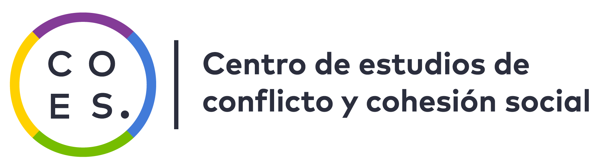
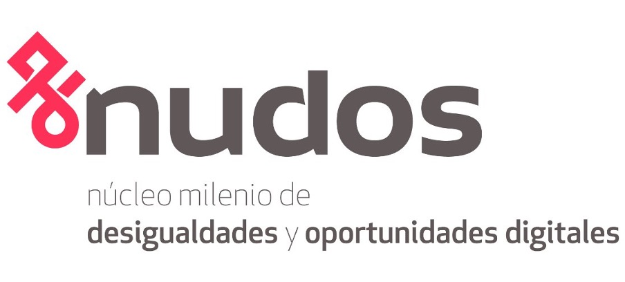
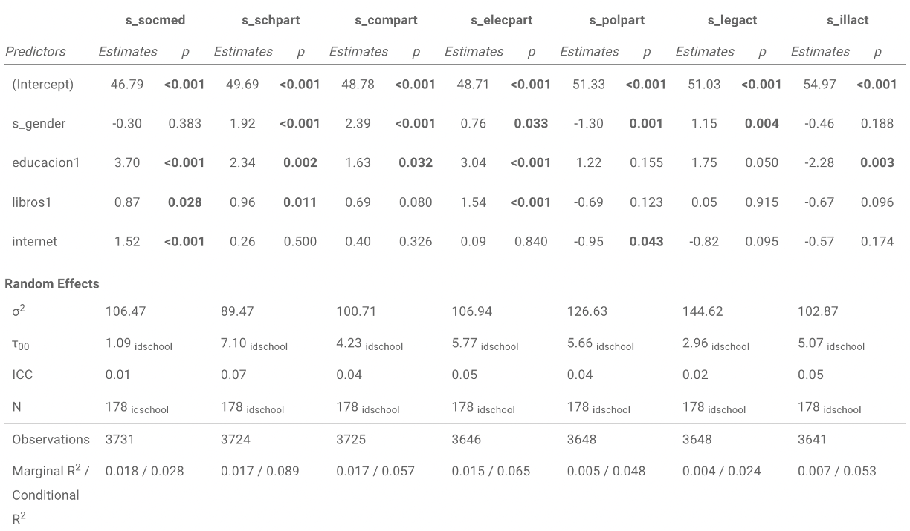
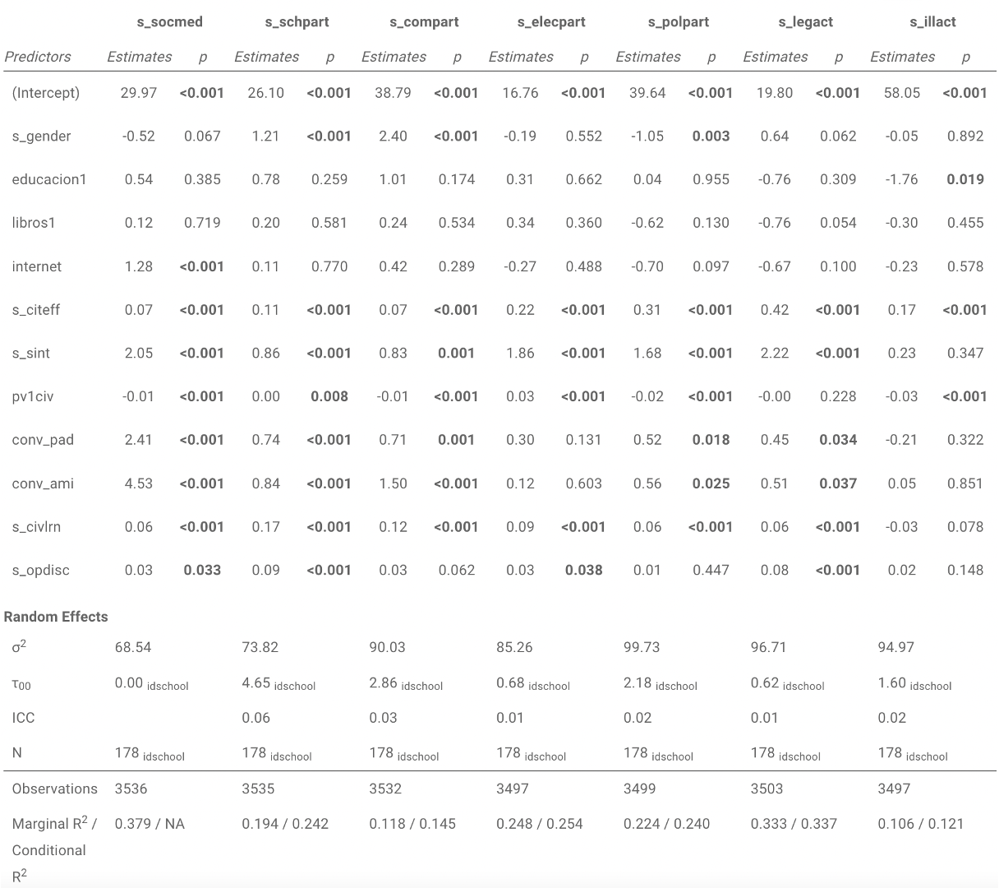
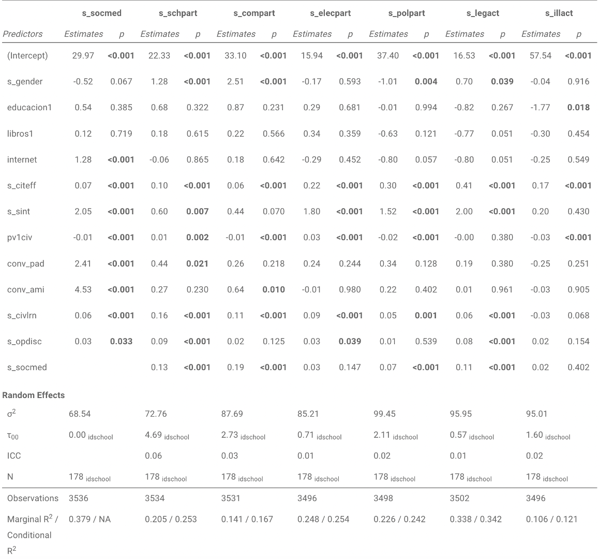
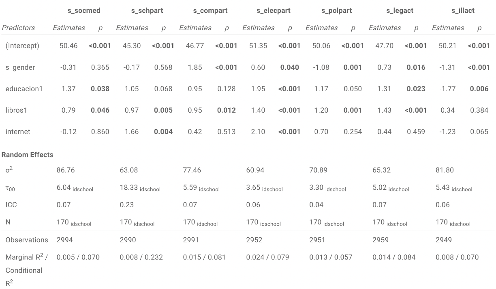
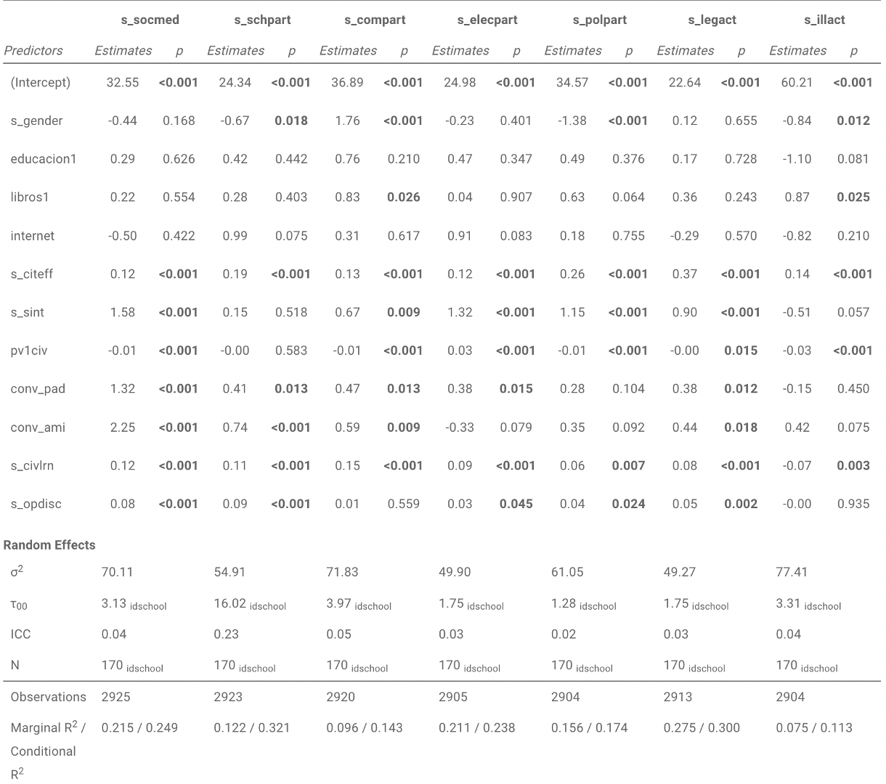
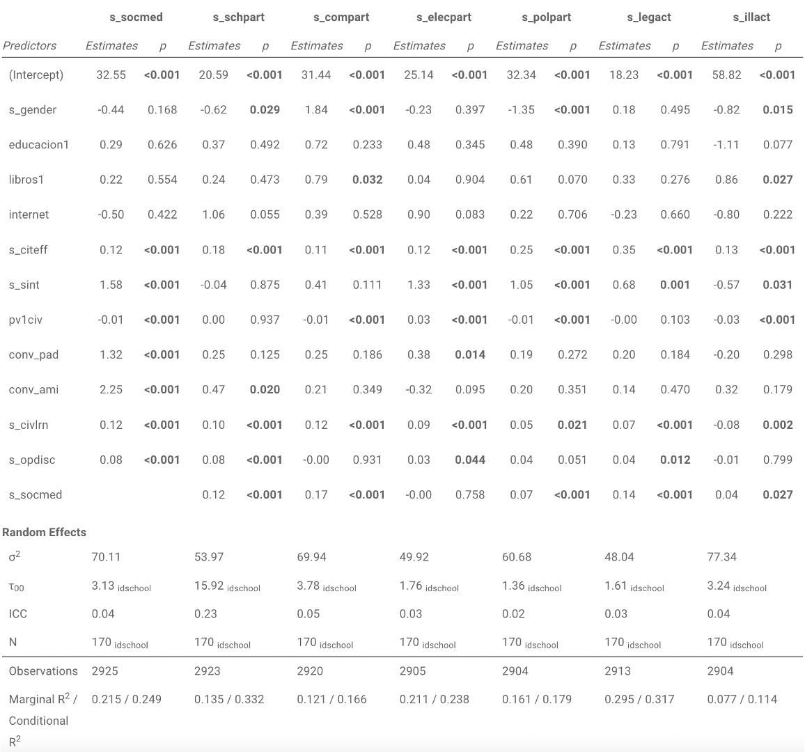
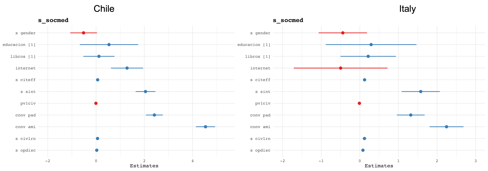

class: front, middle

```{r xaringanExtra, echo=FALSE}
xaringanExtra::use_xaringan_extra(c("tile_view", "animate_css"))
xaringanExtra::use_progress_bar(color = "red", location = "top")

# xaringanExtra::use_share_again()
# xaringanExtra::use_scribble()
```


.pull-left-narrow[
.left[





.tiny[
.grey[
Funding:

ANID/MILENIO-NUDOS/Ncs2022_046

ANID/FONDAP-COES/15130009

]
]

]
]

.medium[
.pull-right-wide[
.right[
.content-box-gray[
.small[
## .black[Digital Citizen Participation in Chile and Italy:]

## .red[description of gaps and their relationship with other forms of participation]
]
]]

.content-box-blue[
.small[
.black[**Daniel Miranda** MIDE-UC, Pontificia Universidad Católica de Chile. 

**Juan C. Castillo** Dept. of Sociology, Universidad de Chile

**Daniel Fuenzalida** Pontificia Universidad Católica de Chile]]

**.small[.black[Contact:].blue[damiran1@uc.cl]**]
]

.content-box-red[
.center[
.small[
**VIII Seminario “I dati INVALSI: uno strumento per la ricerca e la didattica”**
<br style="content:''; padding: 0,3px 0;" />

November 23-26th 2023, Rome, Italy.]
]
]
]
]

---

layout: true
class: animated, fadeIn


---
**Contexto**

- **PRICE**: Research Program in School Citizenship (https://ciudadania-escolar.cl/)

- **NUDOS**: Millennium Nucleus on Digital Inequalities and Opportunities

   - The accelerated expansion of the use of digital tools in different spheres of life has modified multiple aspects of life
  
   - For example, the way in which citizens demonstrate in public spaces
  
     + Understand the ways in which *citizenship* is exercised using digital media
    
---
**Digital Citizenship**

- Different conceptual and measurement approaches (Chen, et al., 2021)

   + Digital competencies (literacy): skills/information
  
   + Use of digital/practical technologies: use of technologies for multiple activities
  
   + Attitudes towards Digital Citizenship: attitudes and feelings towards CD.
  
   + **Digital civic engagement**: participation using digital media.
  
     - Digital vs analogue: online vs offline
  

---
**Research focus**

.pull-left[
.content-box-red[
.red[Gaps]

- Family characteristics (SES and socialization)

- Gender differences

- School characteristics (access and promotion)

- 
]]

.pull-right[
.content-box-yellow[
.red[Links with analog participation]

- Facilitation: as a source of training

- Slacktivism: unconsequential

- What forms of analog participation is digital citizenship related to?

]]

---
**Objectives**

- Explore and map the levels of Digital Citizenship in students.

- Examine Digital Citizenship gaps in terms of academic achievement, gender, family educational level, school characteristics.

- Examine the relationship between the levels of Digital Citizen Participation and Analog Citizen Participation.

---
**Data**

- International Civic and Citizenship Study ICCS 2016.

   + ICCS 2016: 24 countries
   + Chilean sample: 5081 students in 175 schools.
   + Italian sample: 3450 students in 170 schools.

- National representative of 8th grade students.
  
---
**Digital participation measures**

_How often are you involved in each of the following activities? (Please tick only one box in each row.)_

.content-box-red[
- IS3G14G Using the internet to find information about political or social issues
- IS3G14H Posting a comment or image regarding a political or social issue on the internet or social media
- IS3G14I Sharing or commenting on another person’s online post regarding a political or social issue
]

*Response scale: 1-Never or hardly ever, 2-Monthly (at least once a month), 3-Weekly (at least once a week), 4-Daily or almost daily*

---
**Gap variables**

- Internet connection at home: yes/no

- Student sex

- Parents' education: Basic, Secondary, Technical, **University**

- Books at home: **more than 100** vs less

---
**Individual and socialization characteristics**

- Political self-efficacy

- Interest in politics

- Levels of civic knowledge

- Frequency of family conversation about social and political issues

- Frequency of conversation with friends about social and political issues

- Learning opportunities at school (perception)

- School climate open to discussion (perception)

---
**Analog participation variables**

- Participation in school activities: frequency of participation in school activities

- Broad community participation: frequency of participation in community groups

---
**Analog participation variables**

- Intention to participate in elections: national or local elections, get informed

- Intention of political participation: parties, campaigns, etc.

- Intention to participate in legal activism: peaceful march, discussion, contact representatives.

- Intention to participate in illegal activism: taking over a building, scratching walls, making barricades

---
**Methods**

- Descriptive analyzes using complex survey design.

- Multilevel models


---
**Levels of digital citizen participation**

```{r, echo=FALSE, out.width = '95%', fig.retina = 1, fig.align='center'}
knitr::include_graphics("files/frequencies_Chile_Italy.png")

```

---
**Potential role of the school**

```{r, echo=FALSE, out.width = '70%', fig.retina = 1, fig.align='center'}
knitr::include_graphics("files/null_Chile_Italy.png")

```

---
class: inverse animated slideInRight fadeOutLeft

## .yellow[ICCS 2016: Chile
]

 
---
**Sociodemographics gaps: Chile**

```{r, echo=FALSE, out.width = '80%', fig.retina = 1, fig.align='center'}


```

---
**Sociodemographics, individual characteristics and socialization**

```{r, echo=FALSE, out.width = '65%', fig.retina = 1, fig.align='center'}


```

---
**Digital and analogic participation **

```{r, echo=FALSE, out.width = '65%', fig.retina = 1, fig.align='center'}


```


---
class: inverse animated slideInRight fadeOutLeft

## .yellow[ICCS 2016: Italy
]

 
---
**Sociodemographics gaps**

```{r, echo=FALSE, out.width = '80%', fig.retina = 1, fig.align='center'}


```

---
**Sociodemographics, individual characteristics and socialization**

```{r, echo=FALSE, out.width = '65%', fig.retina = 1, fig.align='center'}


```

---
**Digital and analogic participation **

```{r, echo=FALSE, out.width = '65%', fig.retina = 1, fig.align='center'}


```


---
**Brief comparison **

```{r, echo=FALSE, out.width = '90%', fig.retina = 1, fig.align='center'}


```


---
## Discussion

- Information about social and political issues is a more frequent activity than posting or sharing information, even more in Italy.

- In italy, the school has a bit more potential to explain participation than in Chile. Particularly in school participation but in social meadia using as well. 

---
## Discussion

- Some gaps with important nuances are observed

   + There are no differences in digital participation by sex (but sex matters in other forms of participation).
   
   + As expected, having access to the internet is relevant, but only in Chile.
   
   + Education ans mainly books at home too (although it falls into more complete models).

---
## Discussion

   + Self-efficacy, interest in politics are relevant antecedents (not only for the digital dimension)
   
   + Civic knowledge: decrease social media partcipation (not only). Why? 
  
   + Family conversation and, especially with friends, are an important antecedent (political socialization)
  
   + Perceiving learning opportunities and openness to discussion at school are related to digital participation.

  
---
## Discussion

- The frequency of use of digital media to participate is linked to (facilitation):

   + Participation in school and community
   + Expectations of political participation and peaceful protest (legal)
   + In Italy, is connected with intended illegal activism as well. 
  
   + The frequency of using digital media to participate is NOT linked to expectations of electoral participation (slacktivism).

---
## Next steps

- ICCS 2009 Modeling - 8th Grade Students

- International comparison using 2009 and 2016 (even CivEd 1999)

---
class: front middle

.pull-left-narrow[
.left[


.tiny[
.grey[
Funding:

ANID/MILENIO-NUDOS/Ncs2022_046

ANID/FONDAP-COES/15130009

]
]

]
]

.medium[
.pull-right-wide[
.right[
.content-box-gray[
.small[
## .black[Digital Citizen Participation in Chile and Italy:]

## .red[description of gaps and their relationship with other forms of participation]
]
]]

.content-box-blue[
.center[
.black[**Thank you very much!**]

**.small[.black[Contact:].blue[damiran1@uc.cl]**]
]]

.content-box-red[
.center[
.small[
**VIII Seminario “I dati INVALSI: uno strumento per la ricerca e la didattica”**
<br style="content:''; padding: 0,3px 0;" />

November 23-26th 2023, Rome, Italy.]
]
]
]
]

