::: columns
::: {.column width="15%"}
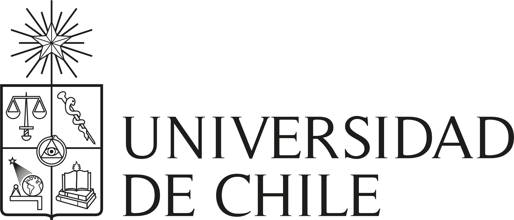

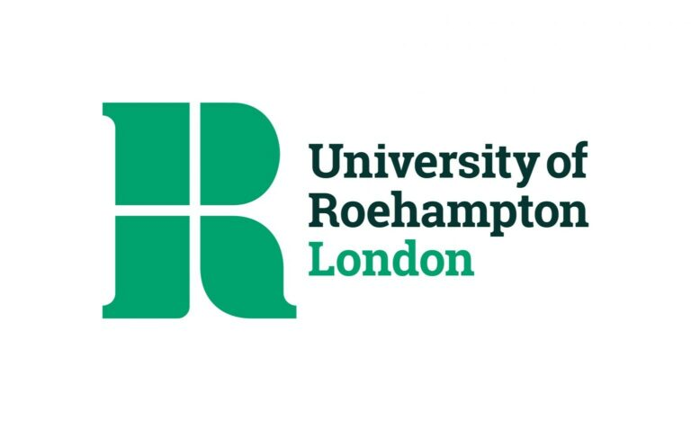

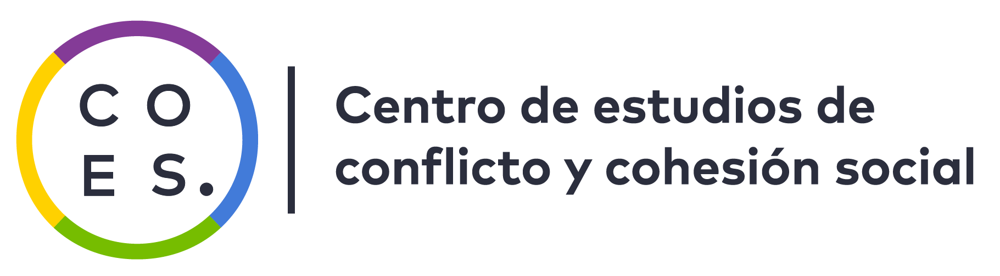
:::

::: {.column .column-right width="85%"}
 

### **Can Civic Education Compensate Social Inequalities in Civic Outcomes? Evidence from Chile and Comparative LargeScale Assessments.**

------------------------------------------------------------------------

**Daniel Miranda**, Departamento de Psicología, Universidad de Chile

**Jorge Matamala**, Universidad del Desarrollo

**Benjamín Zavala**, Universidad de Chile

##### FONDECYT 1240922: Youth political attitudes and behaviors: inequality, school socialization styles and intergenerational influences

11th Annual Conference on Citizenship Education. November 10-11. Roehampton, London, UK.
:::
:::

## Research agenda on citizenship education

-   Why conduct research on this topic?

    -   Current and previous projects on political socialization focused in Chile and in comparative perspective

    -   The general research questions that we address is:

        -   What factors and mechanisms explain the intergenerational transmission of political inequality?

        -   To what extent is the school an agent that reproduces or mitigates the intergenerational transmission of family political inequality?

## Political inequality

::: {.incremental .highlight-last style="font-size: 100%;"}
-   Political inequality is a threat to the principles of the democratic system [@burns1997; @solt2008].

-   The proper functioning of democracy rests on citizens participating on equal terms in decision-making processes, taking an interest in socially and politically relevant issues, adhering to democratic principles, and developing attitudes and knowledge consistent with life in a democratic society.

-   Depending on their educational level, economic resources, gender or national origin, people may have different degrees of access to political voice, interest in politics, knowledge, adherence to democratic values or principles, etc.
:::

## Family background and civic outcomes

::: {.incremental .highlight-last style="font-size: 100%;"}
-   Political inequalities are observed in the adult population and from an early age [@castillo2014; @meirick2004; @miranda2023]

-   The family transmits beliefs, attitudes, knowledge and skills relevant to the exercise of citizenship, directly socializing its sons and daughters.

-   In addition, the family passes on the advantages of its social position to the next generation, which results in the transmission of political inequality.
:::

## Family background and civic outcomes

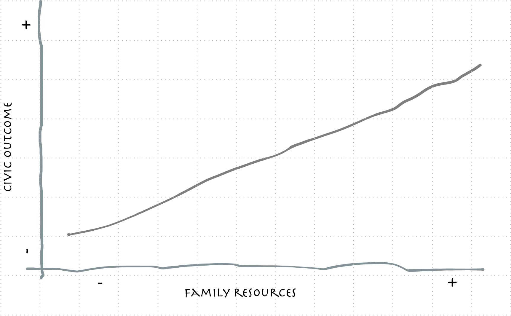

## Compensation hypothesis

::: {.incremental .highlight-last style="font-size: 100%;"}
-   The school system offers a range of activities, defined both formally and informally, that have the potential to develop aspects relevant to the exercise of citizenship.

-   The compensation hypothesis proposes that the school experience, ideally similar for everyone who attends, can level, moderate, mitigate or compensate for the gaps caused by social origin [@campbell2019].

-   @langtonPoliticalSocializationHigh1968 describe how the middle class (socioeconomically advantaged) benefits less from civic education than the working class (socioeconomically disadvantaged, such as the African American population in their study) due to information redundancy (ceiling effect, [@neundorf2016a]).
:::

## Compensation of inequalities (mitigation)

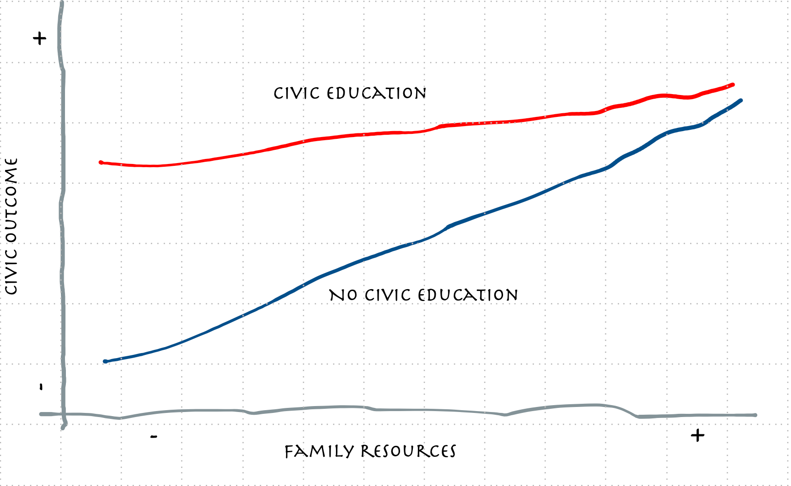

## Maintenance of inequalities

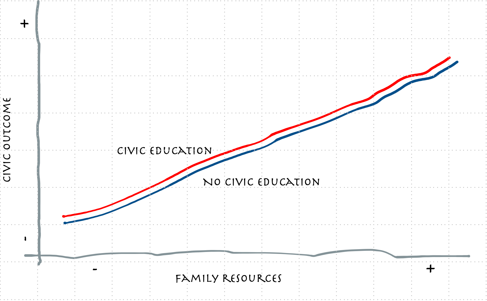

## Increase of inequalities

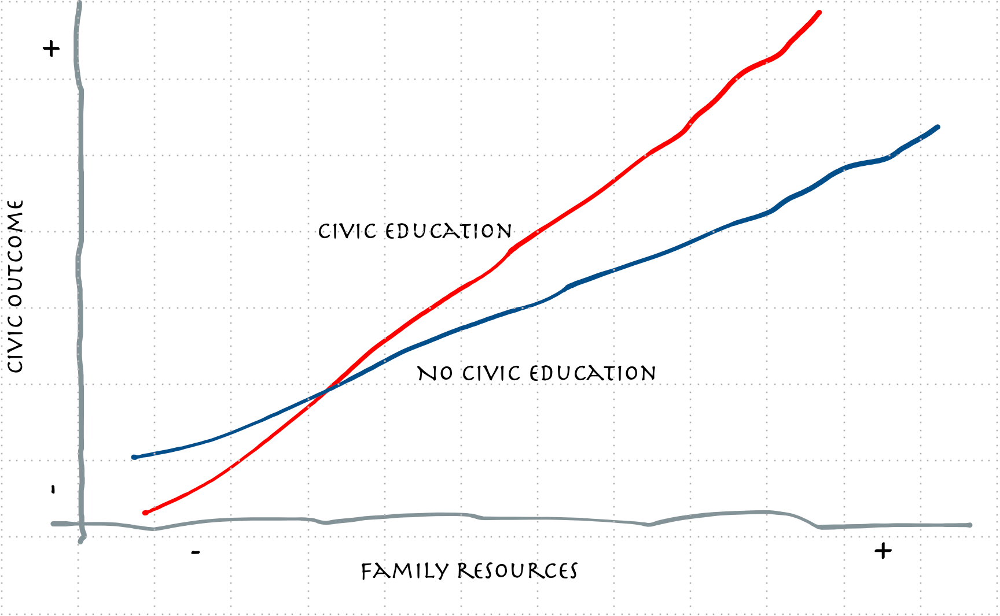

## 

::: {style="font-size: 150%; display: flex; justify-content: center; align-items: center"}
  *This study examines this tension by assessing whether school civic education compensates for inequalities of origin in Chile and in a broad set of countries.*
:::

## Study 1: ICCS 2016

::: {.incremental .highlight-last style="font-size: 100%;"}
-   Based on the international ICCS 2016 study to compare results across countries (starting point given is the newest that Chile participates)

-   **Civic knowledge** was analyzed as the dependent variable, with socioeconomic status as the central predictor.

-   At the school level, **average practices** of an open classroom climate for discussion, participatory activities and formal civic education are considered.

-   At individual level, **perception of** an open classroom climate for discussion, participatory activities and formal civic education are considered.

-   Multilevel hierarchical models were estimated with interactions (*individual and at school level*) between socioeconomic status and school practices.
:::

## Study 2: Chile

::: {.incremental .highlight-last style="font-size: 100%;"}
-   Analyzes the evolution of civic inequalities in Chile using the CIVED 1999, ICCS 2009 and ICCS 2016 datasets and a 2019 national sample (secondary school students).

-   **Willingness to vote** was analyzed as a bynary dependent variable, with socioeconomic status as the central predictor (books and education).

-   At the school level, **average practices** of an open classroom climate for discussion, participatory activities and formal civic education are considered.

-   At individual level, **perception of** an open classroom climate for discussion, participatory activities and formal civic education are considered.

-   Logistic hierarchical models were estimated with interactions (*individual and at school level*) between socioeconomic status and school practices.
:::

## How is civic education defined? {.small}

::: {.incremental .highlight-last style="font-size: 100%;"}
School level (average) and individual perception

-   Content-oriented activities: school subject (at school level)

-   Participation-oriented activities: elections, forums, etc.

-   Focus on social relationships: among students, between students and teachers
:::

# Results {data-background-color="#d3d3d3"}

## Study 1: ICCS 2016

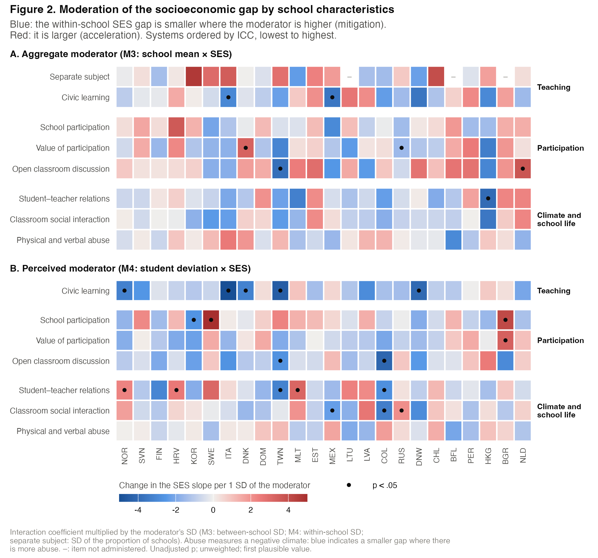{fig-align="center" width="80%"}

## Study 1: ICCS 2016

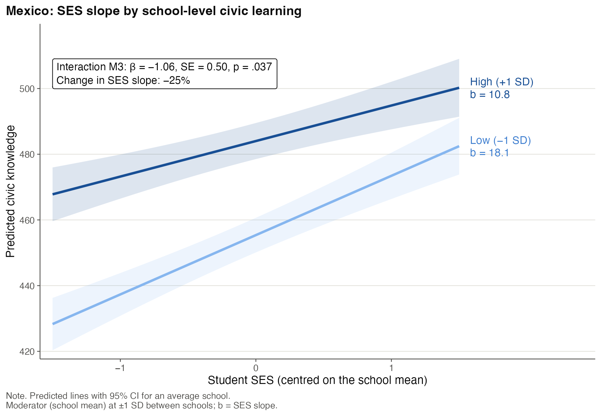{fig-align="center" width="70%"}

## Study 1: ICCS 2016

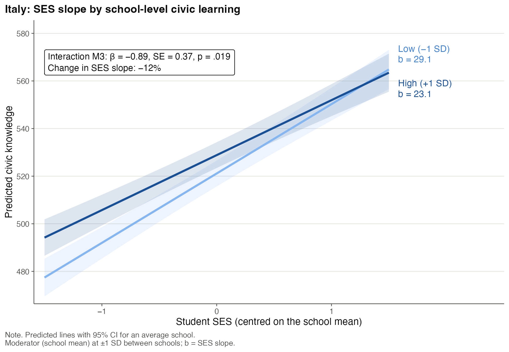{fig-align="center" width="70%"}

## Study 1: ICCS 2016

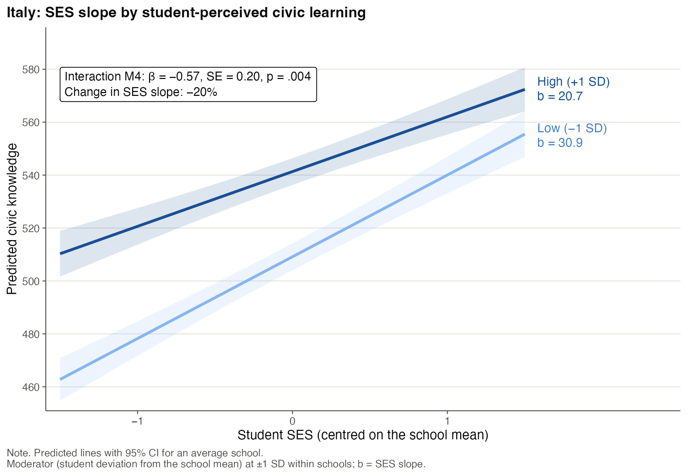{fig-align="center" width="70%"}

## Study 2: Chile

::: {.incremental .highlight-last style="font-size: 100%;"}
-   In all four studies the most common result is *reproduction*. That is, there is no interaction effect.

-   This does not mean that civic education is irrelevant for increasing the intention to vote, but no compensation of inequalities For instance,

    -   The more perception and school average of learning to vote increse the intention to vote.

    -   The more perception and school average of open classroom climate increse the intention to vote.
:::

## Study 2: Chile

One exception: CIVED 1999

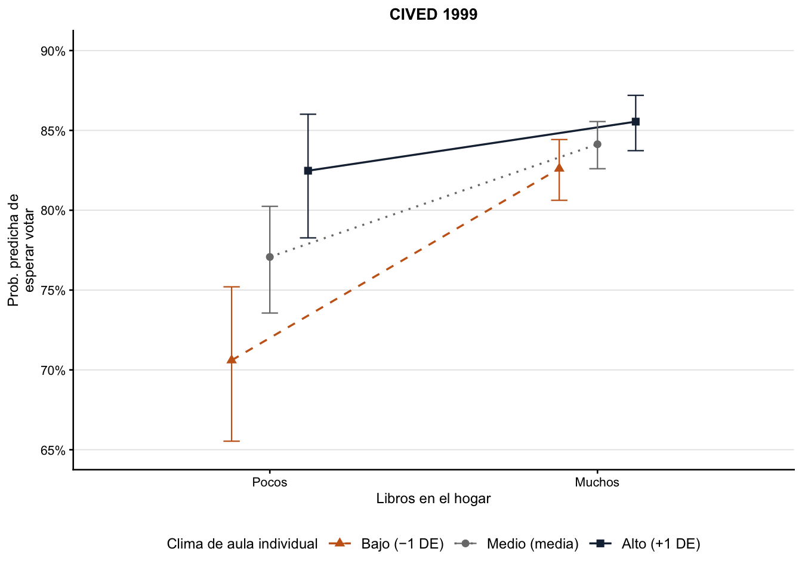{fig-align="center" width="75%"}

# General Discussion

::: {.incremental .highlight-last style="font-size: 100%;"}
-   Evidence for the compensation hypothesis is limited when considering the school as a context (Mexico, Italy, Russia, Taiwan).

    -   Different civic education approaches: subject oriented, participatory oriented (participation and open climate).

-   Evidence for the compensation hypothesis is limited when considering perceptions of the school (12 countries).

    -   Different civic education approaches: participatory oriented (participation/ open climate) and social relations.
:::

# Discussion

::: {.incremental .highlight-last style="font-size: 100%;"}
-   However, an increase in inequalities is also observed (in 2 countries when considering the school as a context, and in 7 when considering perceptions of the school).

-   In Study 2 (Chile), compensation of inequalities is obseved only one time (CIVED 1999: Open classroom climate compensate the effects of books at home).

-   **Therefore, the most common result is reproduction**.
:::

# What's next?

::: {.incremental .highlight-last style="font-size: 100%;"}
-   Systematize the results

-   Integrate all versions of ICCS and future ICCS 2027 releases in the coomparative version

-   Focus on upper secondary education with national data of 2026 (soon) and future ICCS 2027 10 grades
:::

# Thank you very much!

## References
