::: columns
::: {.column width="15%"}
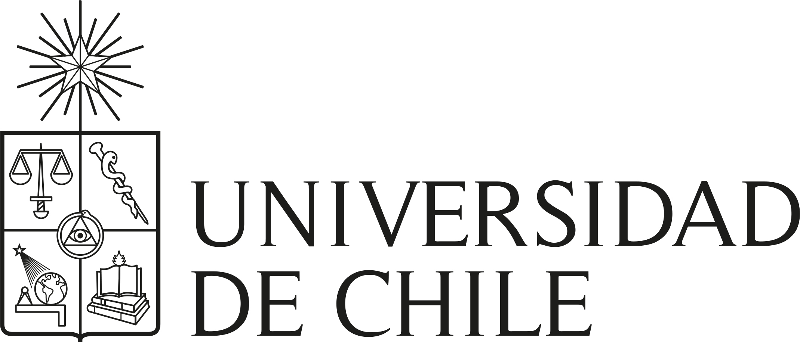

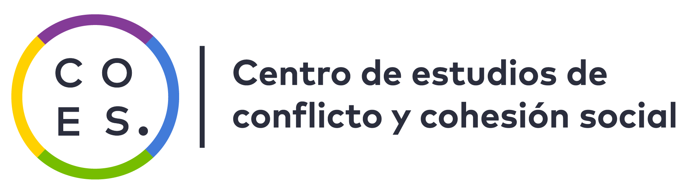
:::

::: {.column .column-right width="85%"}
 

### ¿Puede la educación cívica compensar las desigualdades sociales en los resultados cívicos?
#### Evidencia desde Chile y evaluaciones comparadas a gran escala.

------------------------------------------------------------------------

**Daniel Miranda**, Departamento de Psicología, Universidad de Chile

**Jorge Matamala**, Universidad del Desarrollo

**Benjamín Zavala**, Universidad de Chile

##### FONDECYT 1240922: Actitudes y comportamientos políticos de jóvenes: desigualdad, estilos de socialización escolar e influencias intergeneracionales

**XII Congreso de la Sociedad Científica de Psicología**, 24 al 26 de noviembre. Santiago, Chile.
:::
:::

## Agenda de investigación sobre educación ciudadana

-   ¿Por qué investigar este tema?

    -   Proyectos actuales y anteriores sobre socialización política, centrados en Chile y en perspectiva comparada

    -   Las preguntas generales de investigación que abordamos son:

        -   ¿Qué factores y mecanismos explican la transmisión intergeneracional de la desigualdad política?

        -   ¿En qué medida la escuela es un agente que reproduce o mitiga la transmisión intergeneracional de la desigualdad política familiar?

## Desigualdad política

::: {.incremental .highlight-last style="font-size: 100%;"}
-   La desigualdad política es una amenaza para los principios del sistema democrático [@burns1997; @solt2008].

-   El buen funcionamiento de la democracia descansa en que la ciudadanía participe en igualdad de condiciones en los procesos de toma de decisiones, se interese por los temas social y políticamente relevantes, adhiera a los principios democráticos y desarrolle actitudes y conocimientos coherentes con la vida en una sociedad democrática.

-   Según su nivel educacional, sus recursos económicos, su género o su origen nacional, las personas pueden tener distintos grados de acceso a la voz política, interés en la política, conocimiento, adhesión a valores o principios democráticos, etc.
:::

## Origen familiar y resultados cívicos

::: {.incremental .highlight-last style="font-size: 100%;"}
-   Las desigualdades políticas se observan en la población adulta y desde temprana edad [@castillo2014; @meirick2004; @miranda2023]

-   La familia transmite creencias, actitudes, conocimientos y habilidades relevantes para el ejercicio de la ciudadanía, socializando directamente a sus hijos e hijas.

-   Además, la familia traspasa las ventajas de su posición social a la siguiente generación, lo que se traduce en la transmisión de la desigualdad política.
:::

## Origen familiar y resultados cívicos

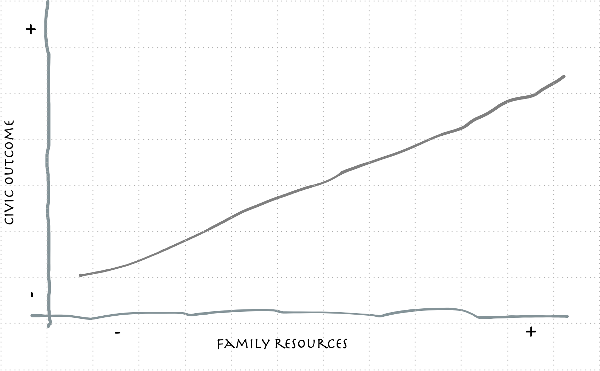

## Hipótesis de compensación

::: {.incremental .highlight-last style="font-size: 100%;"}
-   El sistema escolar ofrece un conjunto de actividades, definidas tanto formal como informalmente, que tienen el potencial de desarrollar aspectos relevantes para el ejercicio de la ciudadanía.

-   La hipótesis de compensación propone que la experiencia escolar, idealmente similar para todas las personas que asisten, puede nivelar, moderar, mitigar o compensar las brechas originadas por el origen social [@campbell2019].

-   @langtonPoliticalSocializationHigh1968 describen cómo la clase media (socioeconómicamente aventajada) se beneficia menos de la educación cívica que la clase trabajadora (socioeconómicamente desaventajada, como la población afroamericana en su estudio) debido a la redundancia de información (efecto techo, [@neundorf2016a]).
:::

## Compensación de desigualdades (mitigación)

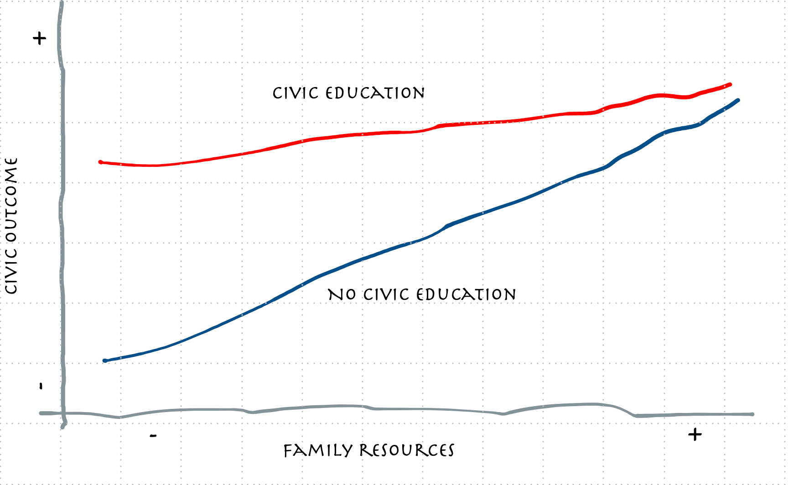

## Mantención de desigualdades

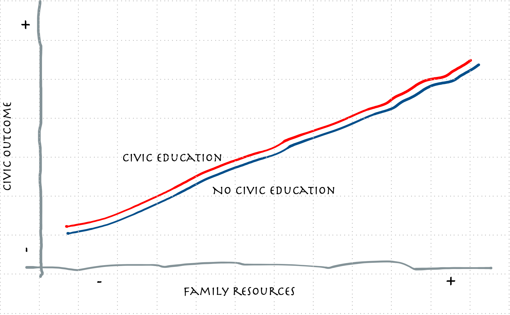

## Aumento de desigualdades

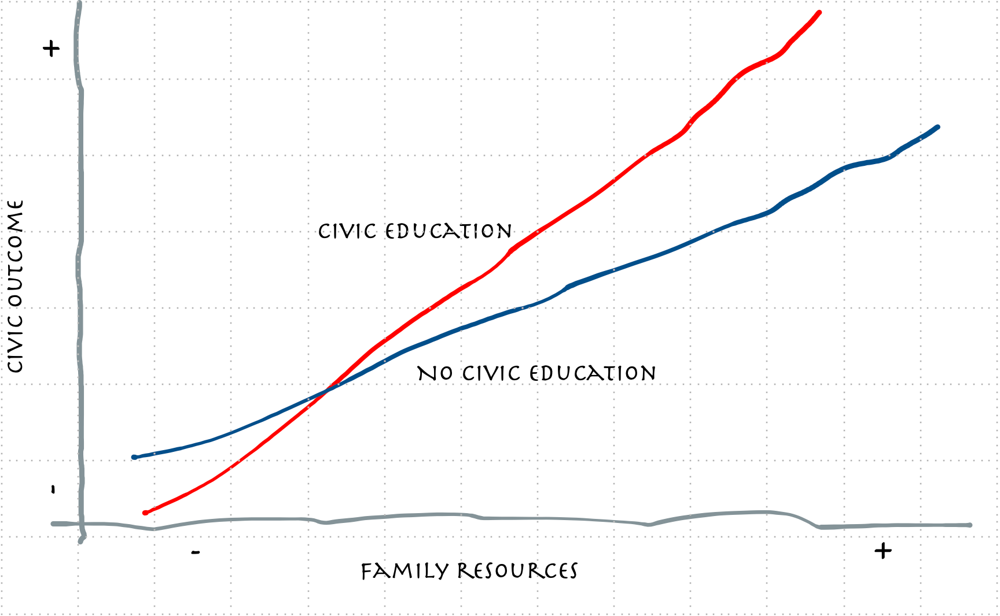

##

::: {style="font-size: 150%; display: flex; justify-content: center; align-items: center"}
  *Este estudio examina esta tensión evaluando si la educación cívica escolar compensa las desigualdades de origen en Chile y en un amplio conjunto de países.*
:::

## Estudio 1: ICCS 2016

::: {.incremental .highlight-last style="font-size: 100%;"}
-   Se basa en el estudio internacional ICCS 2016 para comparar resultados entre países (punto de partida: es la versión más reciente en la que participa Chile)

-   Se analizó el **conocimiento cívico** como variable dependiente, con el nivel socioeconómico como predictor central.

-   A nivel de escuela, se consideran las **prácticas promedio** de clima abierto de discusión en el aula, actividades participativas y educación cívica formal.

-   A nivel individual, se considera la **percepción de** clima abierto de discusión en el aula, actividades participativas y educación cívica formal.

-   Se estimaron modelos jerárquicos multinivel con interacciones (*a nivel individual y de escuela*) entre el nivel socioeconómico y las prácticas escolares.
:::

## Estudio 2: Chile

::: {.incremental .highlight-last style="font-size: 100%;"}
-   Analiza la evolución de las desigualdades cívicas en Chile usando las bases de datos CIVED 1999, ICCS 2009 e ICCS 2016, y una muestra nacional de 2019 (estudiantes de educación media).

-   Se analizó la **disposición a votar** como variable dependiente binaria, con el nivel socioeconómico como predictor central (libros en el hogar y educación de los padres).

-   A nivel de escuela, se consideran las **prácticas promedio** de clima abierto de discusión en el aula, actividades participativas y educación cívica formal.

-   A nivel individual, se considera la **percepción de** clima abierto de discusión en el aula, actividades participativas y educación cívica formal.

-   Se estimaron modelos jerárquicos logísticos con interacciones (*a nivel individual y de escuela*) entre el nivel socioeconómico y las prácticas escolares.
:::

## ¿Cómo se define la educación cívica? {.small}

::: {.incremental .highlight-last style="font-size: 100%;"}
Nivel de escuela (promedio) y percepción individual

-   Actividades orientadas al contenido: asignatura escolar (a nivel de escuela)

-   Actividades orientadas a la participación: elecciones, foros, etc.

-   Foco en las relaciones sociales: entre estudiantes, y entre estudiantes y docentes
:::

# Resultados {data-background-color="#d3d3d3"}

## Estudio 1: ICCS 2016

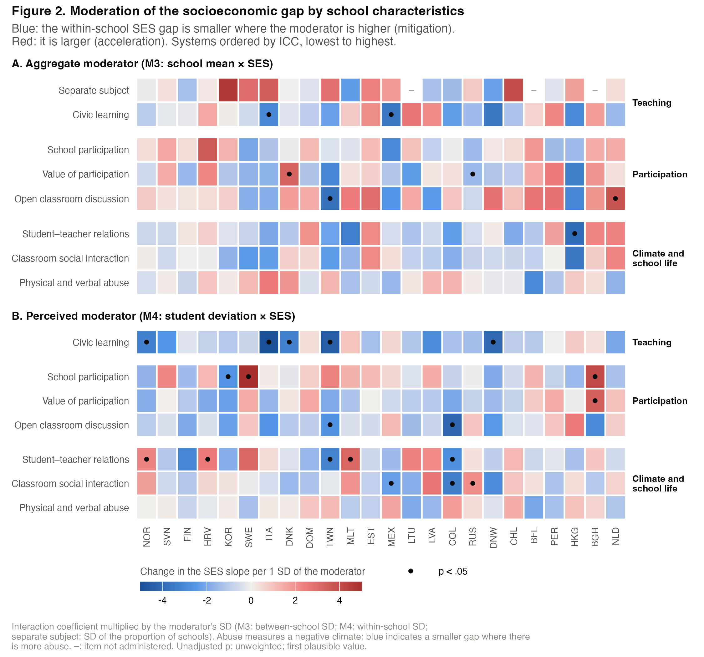{fig-align="center" width="80%"}

## Estudio 1: ICCS 2016

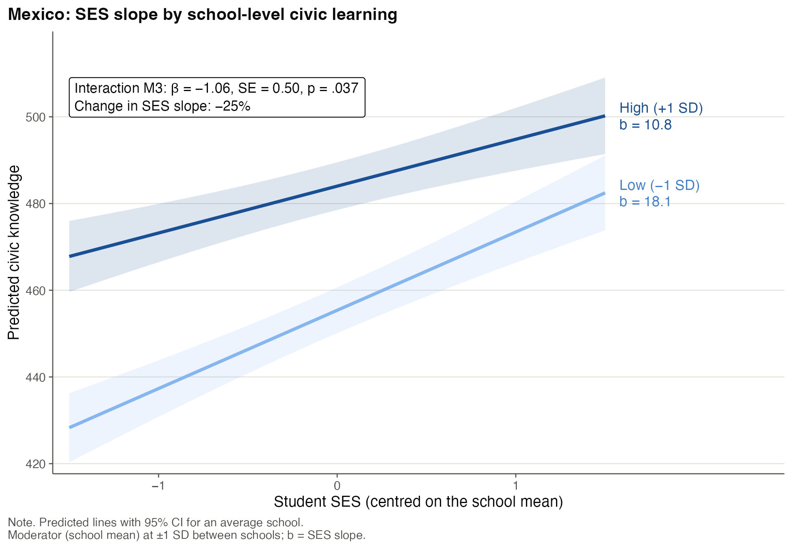{fig-align="center" width="70%"}

## Estudio 1: ICCS 2016

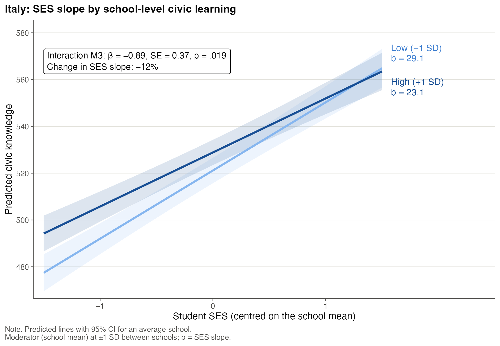{fig-align="center" width="70%"}

## Estudio 1: ICCS 2016

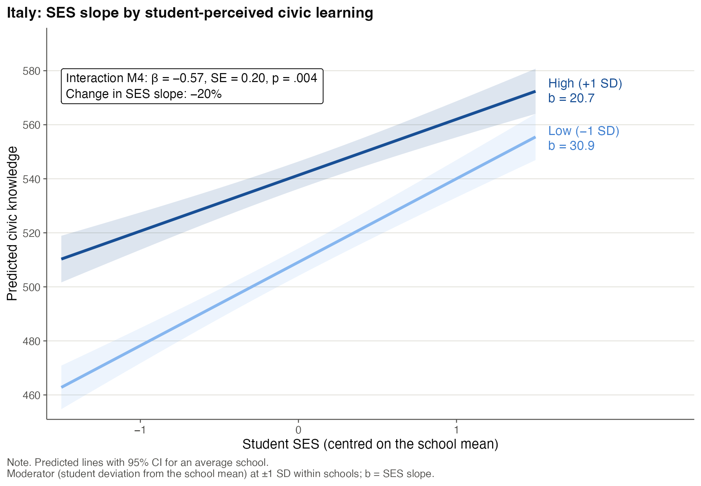{fig-align="center" width="70%"}

## Estudio 2: Chile

::: {.incremental .highlight-last style="font-size: 100%;"}
-   En los cuatro estudios, el resultado más común es la *reproducción*. Es decir, no hay efecto de interacción.

-   Esto no significa que la educación cívica sea irrelevante para aumentar la intención de votar, pero no hay compensación de desigualdades. Por ejemplo:

    -   A mayor percepción y promedio escolar de aprendizaje sobre el voto, mayor intención de votar.

    -   A mayor percepción y promedio escolar de clima abierto en el aula, mayor intención de votar.
:::

## Estudio 2: Chile

Una excepción: CIVED 1999

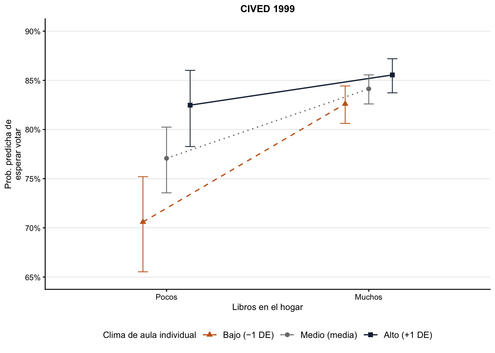{fig-align="center" width="75%"}

# Discusión general

::: {.incremental .highlight-last style="font-size: 100%;"}
-   La evidencia a favor de la hipótesis de compensación es limitada cuando se considera la escuela como contexto (México, Italia, Rusia, Taiwán).

    -   Distintos enfoques de educación cívica: orientado a la asignatura y orientado a la participación (participación y clima abierto).

-   La evidencia a favor de la hipótesis de compensación es limitada cuando se consideran las percepciones de la escuela (12 países).

    -   Distintos enfoques de educación cívica: orientado a la participación (participación / clima abierto) y relaciones sociales.
:::

# Discusión

::: {.incremental .highlight-last style="font-size: 100%;"}
-   Sin embargo, también se observa un aumento de las desigualdades (en 2 países al considerar la escuela como contexto, y en 7 al considerar las percepciones de la escuela).

-   En el Estudio 2 (Chile), la compensación de desigualdades se observa solo una vez (CIVED 1999: el clima abierto en el aula compensa los efectos de los libros en el hogar).

-   **Por lo tanto, el resultado más común es la reproducción**.
:::

# ¿Qué viene?

::: {.incremental .highlight-last style="font-size: 100%;"}
-   Profundizar en países específicos, por ejemplo, Italia.

-   Integrar todas las versiones de ICCS y las futuras publicaciones de ICCS 2027 en el análisis comparado.

-   Enfocarse en la educación media superior con datos nacionales de 2026 (próximamente) y con el futuro ICCS 2027 de 10.º grado.
:::

# ¡Muchas gracias!

## Referencias
